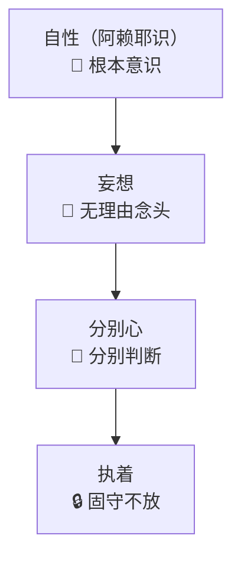

> [!abstract] 概述
> 本文是「两条逻辑主线」中的下堕线：自性（阿赖耶识）无因起妄，依次发展出妄想、分别心、执着心，最终由阿罗汉堕为凡夫、进入分段生死。
>
> 上行的反向路径见 [[3-修行次第]]；这条线终点所对应的世界层级见 [[世界结构]]。

# 一、心识发展：从自性到执着

> [!info] 心识发展顺序
> 心识从自性（阿赖耶识）开始，依次产生妄想、分别心、执着，这是堕落的过程。

## 四个阶段

1. **自性（阿赖耶识）** 🌊 —— 根本意识，遍虚空
2. **妄想** 💭 —— 无理由产生的念头
3. **分别心** 🤔 —— 对妄想的分别判断
4. **执着** 🔒 —— 对分别结果的固守

## 三个层次

- **菩萨层次**：十一层妄想（自性阿赖耶识中起妄想）
- **阿罗汉层次**：九种分别心（末那识成型）
- **凡夫层次**：九种执着（以禅定来划分，第六意识执着心）

> [!info] 关键说明
> 妄想是可数的。阿赖耶识没有起妄想的状态就是佛；起了一个妄想就是等觉菩萨；而后两个、三个、四个到十一个，就是初地菩萨。

> [!info] 层次转换
> 菩萨起了分别心就是阿罗汉了。

> [!important] 堕落过程
> 阿罗汉有九种分别心，一个、两个、三个到九个；九种分别心发展到极致，开始执着于守住当下这个妄想的时候，就沦为凡夫——也就是下文「从阿罗汉到凡夫」与「执着心的十个阶段」所讲的过程。

## 唯识论视角

| 识 | 名称 | 说明 |
|----|------|------|
| **第八识** | 阿赖耶识 | 根本识 |
| **第七识** | 末那识 | 我执识 |
| **第六识** | 意识 | 分别识 |
| **前五识** | 眼耳鼻舌身 | 感官识 |

## 佛的状态

- **入涅槃时**：眼耳鼻舌身意和第七识消失
- **只剩下**：没有妄想的阿赖耶识
- **处于**：不生灭、不增减状态

---

# 二、从阿罗汉到凡夫

## 核心转变：从分别心到执着心

当阿罗汉的九种分别心发展到极致后，会出现新的认识——第六识执着心。这一执着就使阿罗汉变成凡夫，进入轮回。

## 机制：分段生死

### 产生条件

阿罗汉认知到自己在不断打妄想，记忆包不断变大，想要阻止这种状况持续下去。阿罗汉以为只要守住当下的妄想、不再起新的妄想，就能阻止记忆包的增大。

### 执着的产生

当阿罗汉的意识里出现「守住当下妄想的执念」时，就会产生分段生死，从此跌落为凡夫。这个「守住当下妄想的执念」就是第一个执着，也叫「对妄想本身的执着」。

### 分段生死的过程

1. **分段标记**：对溪流般连续不断的妄想插入标记，分成了段
2. **生死体验**：凡夫要守住这一段的妄想；当这一段的妄想消失时，凡夫体验到死亡；新的妄想产生时，凡夫体验到新生
3. **循环往复**：「守住当下妄想的执念」又开始起作用，要守住新一段的妄想，从此生死相继

## 转变节点

- **执念产生时**：阿罗汉想执着于当下的妄想、想守住这个妄想时，他还是阿罗汉
- **妄想消失时**：这个妄想一熄灭，阿罗汉就在世界上消失
- **新妄想升起时**：新的妄想一升起，就跌落为非想非非想处天的众生，成为凡夫

## 四相完成

这个转变过程完成了四相的形成：

- **我相、人相**：在分别心阶段产生
- **众生相**：在众生分别时产生
- **寿者相**：在分段生死产生时出现

> [!summary] 关键总结
> 阿罗汉九种分别心后变成凡夫，关键在于产生了「守住当下妄想的执念」。这个执着导致了分段生死，使原本没有生死的阿罗汉进入了生死轮回。

---

# 三、执着心的十个阶段

> [!note] 发展脉络
> 执着心从对妄想本身的执着开始，逐步发展到对具体感官和欲望的执着；阳神从覆盖整个虚空的状态，逐步收缩、凝聚，最终形成凡夫的身心状态。

## 对应总表

| 阶段 | 执着对象 | 对应天界 |
|------|----------|----------|
| 1 | 妄想本身 | 非想非非想处天 |
| 2 | 「无」 | 无所有处天 |
| 3 | 自己的意识 | 识无边处天 |
| 4 | 遍虚空的意识 | 空无边处天 |
| 5 | 我执（无内容的情绪） | 净居五天（四禅上五天） |
| 6 | 喜情 | 四禅下四天 |
| 7 | 苦情 | 三禅三天 |
| 8 | 眼、身、耳三根境界 | 二禅三天 |
| 9 | 鼻、舌二根境界 | 初禅三天 |
| 10 | 淫欲 | 欲界六天 |

## 逐步展开

### 第一步：非想非非想处天

这是「对妄想本身的执着」形成的。执着于当下的妄想，想让它持续下去，而不做新的妄想。非想非非想：不是想，因为这个想是没有内容的；不是不想，想还在继续。

### 第二步：无所有处天

在没有内容的执着中产生了内容，最初的具体内容就是「无」。认知到啥都没有，没有自己，没有认识的客观对象，对「无」的执着形成了无所有处天。

### 第三步：识无边处天

出现对自己的执着，认为有我啊，我的意识无边大啊。识无边处天的执着，是对自己意识的执着。

### 第四步：空无边处天

我无边的意识覆盖无边的虚空——人的意识可以认知整个虚空，没有任何障碍。

### 第五步：净居五天（意识开始收缩）

从这里开始，我执出现——就是没有内容的情绪。意识开始收缩，这个意识叫阳神。在我执的作用下，阳神开始一点一点收缩，但是从阳神延伸出去的感知能力还可以认知整个虚空。这个过程对应四禅九天中的上五天：无烦恼天、无热天、善见天、善现天、色究竟天。

> [!info] 情绪出现
> 情绪出现就会有引力点。

### 第六步：四禅天下四天（喜情发展）

人的我执逐渐发展出喜情——自我存在的满足感，感觉自己是一个活人。当人出现喜情的时候，阳神进一步收缩，阳神外围出现不能认知的部分，向外延伸出去的感知能力也不能企及的地方，这就是黑暗。这个过程对应于四禅九天中的下四天：福生天、福爱天、广果天、无想天。

> [!info] 情绪加重
> 情绪加重，引力点增强，阳神意识收缩加剧。

### 第七步：三禅三天（苦情出现）

喜生苦，接下来出现各种痛苦的情绪——不安、忧郁、悲伤、苦闷、恐惧、嗔恨、嫉妒等等，一切都是苦情。苦、喜二情生发「名色」，开始出现五根境界。

### 第八步：二禅三天（眼身耳三根境界）

最初出现的是眼根境界——外有尘、中有根、内有识（眼尘、眼根、眼识）。接着出现身根境界，然后出现耳根境界。这三根境界对应二禅三天。

### 第九步：初禅三天（鼻舌二根境界）

再往下出现鼻根境界和舌根境界，这二根境界对应初禅三天。

### 第十步：欲界六天（淫欲）

最后就是淫欲了——对应欲界六天，以对淫欲的执着程度划分。对众生的执着发展越演越烈。

> [!success] 总结
> 整个堕落过程，就是从对妄想本身的执着，逐步发展到对具体感官和欲望的执着；阳神从覆盖整个虚空的状态，逐步收缩、凝聚，最终形成了凡夫的身心状态。

---

# 相关

- [[1-世界观]] —— 总纲：三条底层设定、三观体系与两条逻辑主线
- [[3-修行次第]] —— 反向路径：执着 → 分别 → 妄想 → 自性
- [[4-自性重叠逻辑线]] —— 支撑上行的诸佛同体、业力与传法机制
- [[世界结构]] —— 三界二十八天，与本文十个阶段的对应

---

*最后更新：2026-11-22*
